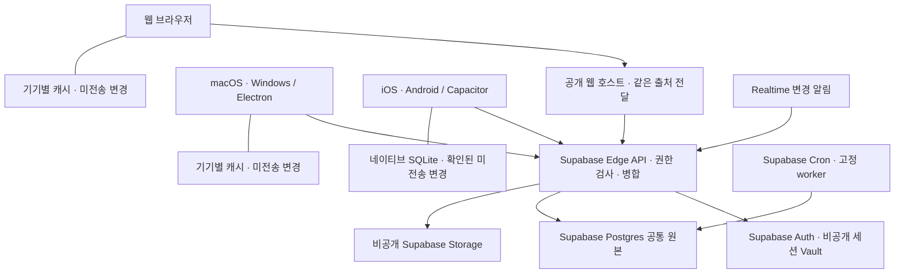

# 웹·데스크톱·모바일과 공통 계정 설계

2026-10-17 재점검. 목표는 웹, macOS, Windows, iOS, Android에서 같은 계정으로 같은 작업공간을 사용하는 것이다. 가족 구성원은 각각의 계정을 사용하고, 공유한 자료만 서로 볼 수 있어야 한다. Supabase 백엔드와 설치 앱의 연결은 구현됐지만 원본 소유자 연결·공개 웹 호스팅·전체 다섯 플랫폼 검증까지 끝난 상태는 아니다.

## 현재 확인한 상태

| 항목 | 확인한 구현 | 아직 필요한 작업 |
| --- | --- | --- |
| 웹 | 공통 편집기·계정·권한·공동 편집·오프라인 캐시, 공개 자산과 같은 출처 전달 경로의 배포물 | 무료 호스트 확인·실제 HTTPS 호스팅·호스트를 통한 쿠키/SSE/Range 검증 |
| macOS·Windows | Electron 44.8.0, 번들 UI와 비공개 세션의 Supabase 직접 연결, macOS arm64 실제 로그인·편집·두 프로필 동기화·첨부, Windows x64 portable 생성·검사 | Windows OS 실행, 릴리스 서명·설치·업데이트 |
| iOS·Android | Capacitor 8.5.3, 비공개 네이티브 HTTPS·Keychain/Keystore, 기본 활성 SQLite outbox, 실제 Simulator/Emulator 5단계 실행 | 물리 기기·전원 차단·장시간 대용량 사용·릴리스 배포 |
| 기기 간 동기화 | 별도 QA 공간에서 브라우저 두 세션·macOS 두 프로필과 Android→iOS→Android 순차 편집 확인 | 실제 가족 계정과 다섯 플랫폼 전체 전파·동시 편집 |
| Supabase | Edge Functions·Auth·Postgres·비공개 Storage·Realtime·Cron의 구현과 격리된 실제 클라우드 검증 | 원본 소유자 연결·운영 전환·원본 예약/정리 등록·실제 AI 공급자 연결 |

승인한 Electron/Capacitor 버전을 고정하고 두 데스크톱 패키지와 iOS/Android 프로젝트를 생성했다. [데스크톱 실행·검증](../apps/desktop/README.md)과 [모바일 실행·한계](../apps/mobile/README.md)를 구분한다. 모바일 크기의 Chrome 테스트는 네이티브 앱 검증을 대신하지 않는다. `localhost:8787`은 접속하는 기기 자신을 가리키므로 휴대폰에서 같은 주소를 여는 것만으로 PC 데이터에 연결되지는 않는다.

## Notion 조사로 확인한 범위

설치된 macOS Notion 7.39.0 번들의 REA 분석에서 Electron의 preload 연결과 SQLite 관련 코드를 확인했다. 분석 대상·해시·재현 결과는 [Desktop 조사](research/notion-desktop.md)에 있다. 이것은 모바일 바이너리나 서버 전체를 조사했다는 뜻이 아니다.

[Electron 공식 문서](https://www.electronjs.org/docs/latest/)의 대상은 Windows·macOS·Linux다. iOS·Android를 Electron 빌드 대상으로 간주하면 안 된다.

[Notion의 2024-05-01 Android 기술 글](https://www.notion.com/blog/notion-on-android-is-now-more-than-twice-as-fast-to-launch)은 WebView 래퍼에서 네이티브 화면으로 확장한 과정과 SQLite 블록 저장, 실시간 데이터 처리, WebView와 네이티브 계층의 MessagePort 통신을 설명한다. 해당 시점의 공식 설명이며 현재 iOS/Android 앱 전체 소스나 최신 바이너리를 검증한 결과는 아니다.

따라서 기존 문서·DB·권한·동기화 구현은 공통 기반으로 유지하되, 데스크톱 분석만으로 모바일 설계가 끝났다고 판단하지 않는다.

## 목표 구조

Electron과 Capacitor는 승인받은 프로젝트 전용 의존성을 사용한다. 데스크톱과 모바일은 공개 UI를 번들에 담고 별도의 비공개 전송 계층으로 공통 API에 연결한다. 모바일은 정확한 기본 Supabase 프로젝트 origin에서만 네이티브 내부의 고정 함수 접두사를 사용한다. 주소 입력은 순수 HTTPS origin이며 임의 함수 URL·헤더·리디렉션이나 TLS 예외를 허용하지 않는다. [Capacitor v8 공식 문서](https://capacitorjs.com/docs)의 컨테이너 구조를 사용하며 성능·접근성은 물리 기기에서 추가 확인해야 한다.

모든 클라이언트는 같은 서버 주소와 작업공간 ID를 사용한다. 각 앱에 독립 Python 서버와 새 원본 SQLite DB를 기본으로 넣으면 데이터가 갈라지므로 이 방식으로 기기 간 동기화를 구현하지 않는다. 로컬 서버를 운영하는 경우에도 가족이 연결하는 서버는 하나다.

같은 계정의 기기들은 동일한 사용자 ID를 사용하되 로그인 세션은 기기별로 갖는다. 캐시는 서버 주소·작업공간·사용자·로그인 binding으로 분리한다. 한 기기의 로그아웃은 해당 기기의 캐시를 지우고, 전체 세션 종료나 구성원 비활성화는 서버에서 별도로 집행해야 한다.

문자 편집은 기존 CRDT를 재사용한다. DB 행·페이지 메타데이터는 변경 ID, 수정 전 값, 속성 정의를 가진 작업으로 전송한다. 서버는 현재 권한을 재검사하고, 같은 작업의 재전송을 중복 적용하지 않으며, 동일 필드 충돌은 복구 가능한 상태로 남긴다. 서버가 적용했다고 응답해도 해당 변경을 포함한 원본 스냅샷을 영구 저장하기 전에는 로컬 복구 기록을 지우지 않는다.

## Supabase 도입 경계

승인받은 무료 조직의 서울 프로젝트에 기존 자료를 PostgreSQL로 이관했다. `localhost:8787`은 기존 Python 호환 미리보기로 보존하며 SQLite 원본·백업·기존 계정과 binding도 남긴다. 이 호환 경로의 POSIX 첨부 디렉터리와 별도로, 새 클라우드 경로는 Supabase Auth·Edge·Postgres·Storage를 사용한다. 최종 운영에 Python 프로세스나 항상 켜진 개발자 Mac을 요구하지 않는다. [현재 백엔드와 운영 전환 범위](supabase-backend.md), [보존한 호환 실행](SUPABASE.md)을 구분한다.

| 구성 | 도입 시 역할 | 보존해야 할 동작 |
| --- | --- | --- |
| Auth | 모든 플랫폼의 사용자 식별·세션 | 사용자 ID와 기존 가족 멤버 매핑, 계정 철회·기기별 로그아웃 |
| Postgres | 문서·DB·권한·동기화 기록의 공통 원본 | 작업별 원자적 변경, 중복 방지, 스냅샷 revision, 숨긴 관계 보존 |
| Realtime | 권한 있는 클라이언트에 변경 알림 | 알림을 받은 뒤 현재 권한으로 원본 재조회, 누락·재접속 복구 |
| 비공개 Storage | 첨부·백업 바이트 | 접근 권한, 이어 올리기, 해시, 백업·복원, 용량 예약과 물리 정리 |
| Edge API·worker | 도메인 API·CRDT·예약 실행·AI 연결 | 현재 권한 재검사, 서버 측 비밀 관리·감사 기록, 짧은 실행 단위와 재시도 |

Realtime은 재조회를 깨우는 변경 알림이며 오프라인 병합·충돌 처리·영구 작업 큐 자체가 아니다. 원본 JSON이나 비공개 문서 본문을 전체 작업공간에 방송하지 않는다. 공개 웹 호스트는 UI와 얇은 전달 경로만 제공하며 업무 데이터·service key·Python 서버를 넣지 않는다.

Auth 사용자 UUID는 신뢰된 연결 절차로 기존 멤버 ID·role·ACL에 매핑한다. 가입 순서·이메일·사용자가 수정하는 `user_metadata`로 owner를 만들지 않는다. 현재 Store RPC는 신뢰된 서버의 권한 검사이며 최종 사용자별 RLS라고 설명하지 않는다. private 테이블 직접 접근은 차단하고 모든 요청에서 현재 작업공간·멤버·문서 권한을 확인한다. JWT·refresh token·secret/service-role 키는 웹·Electron renderer·모바일 번들에 넣지 않는다. 외부 IdP·SAML 연결은 아직 남아 있다.

Supabase의 [로그아웃 기본 scope는 global](https://supabase.com/docs/guides/auth/signout)이므로 기기별 로그아웃에는 `local`을 명시한다. 이미 발행한 access JWT는 만료 전까지 유효할 수 있다. 즉시 철회가 필요한 API는 서명·만료 검증에 더해 현재 세션의 유효성을 확인해야 한다. 공식 [세션 검증 안내](https://supabase.com/docs/guides/auth/sessions#how-to-ensure-an-access-token-jwt-cannot-be-used-after-a-user-signs-out)를 따른다. 로컬 cache binding은 주기적으로 갱신되는 access JWT 문자열 대신 안정적인 세션 식별자에 연결한다.

Postgres 어댑터는 실제 트랜잭션·SAVEPOINT·작업공간 잠금으로 작업의 원자성을 보존한다. 첨부 조각과 presence의 저장소 경계를 공통 연산으로 분리했다. 여러 REST 요청으로 트랜잭션을 대신하지 않는다. 이관은 기존 SQLite를 보존한 상태에서 임시 대상의 개수·해시·권한·작업 재전송을 검증한 뒤 전환한다.

[Supabase DB 백업은 Storage 객체 바이트를 포함하지 않는다](https://supabase.com/docs/guides/platform/backups). 기존 SQLite 전체 백업과 동등한 복구를 제공하려면 DB dump와 객체 파일·해시 manifest를 함께 보관하고 참조가 일치하는 시점으로 복원해야 한다. Free에서 관리형 자동 DB 백업까지 제공된다고 가정하지 않으며, 직접 내보내기와 실제 복원 검증이 필요하다.

### 무료 사용의 범위

2026-10-16 [Supabase 가격표](https://supabase.com/pricing)에서 확인한 Free 기준은 DB 500MB, 파일 저장소 1GB, 일반 egress 5GB와 cached egress 5GB다. 비활성 프로젝트는 일주일 후 일시 정지될 수 있다. [Storage 한도 문서](https://supabase.com/docs/guides/storage/uploads/file-limits)의 무료 플랜 파일당 최대치는 50MB다. 이후 변경될 수 있으므로 실제 프로젝트 연결 때 다시 확인한다.

Python 호환 저장소의 실제 5GB 읽기·범위 다운로드·백업 복원은 Supabase의 5GB 전송 증거가 아니다. 클라우드 첨부는 작은 Storage 객체와 manifest로 나누지만 총 저장량·전송량·실행 한도는 그대로 적용된다. 실제 클라우드의 9MiB+123바이트 첨부와 분할 백업 검증 범위는 [백엔드 안내](supabase-backend.md)를 따른다. 무료 DB에는 문서 이력·동기화 기록 증가도 고려해야 한다. 앱 안에 플랜 제한을 넣지 않는 것과 호스팅·저장소·네트워크·AI 공급자의 비용은 별개이며 무제한 용량·상시 가용성을 보장하지 않는다.

## 운영 전환과 배포에 남은 작업

1. 원본을 백업한 뒤 실제 소유자가 비공개 UI에서 계정을 연결하고 가족 계정을 구성한다. 기존 멤버·권한·문서·첨부를 보존하며 관리용 Supabase 로그인만으로 앱 소유자를 추정하지 않는다.
2. 무료 사용 조건을 확인한 공개 HTTPS 웹 호스트를 연결한다. 정확한 origin만 허용하고 실제 쿠키·로그아웃·SSE·Range·업로드·공개 페이지 로그인 복귀를 그 주소에서 검증한다. 복사할 문서 링크도 검증된 공개 웹 주소를 사용해야 한다.
3. 원본의 자동화 설정을 검토한 뒤 예약 실행·첨부/백업 정리를 해당 작업공간에 등록한다. 실제 AI 공급자도 별도로 설정·검증해야 하며 개인 구독이나 유료 API를 자동 전환하지 않는다.
4. Windows OS 실행과 물리 모바일 기기의 키보드·파일·공유·중단/복귀·저장 실패를 검증한다. 서명·설치 프로그램·업데이트·스토어 배포는 별도이며 실제 배포에는 사용자 계정과 서명 설정이 필요할 수 있다.
5. 같은 실제 계정으로 다섯 플랫폼 전체 전파·동시 편집·오프라인 재접속·권한 철회·늦은 응답 차단을 확인한다. 기존 8787 호환 경로와 원본·백업은 복구 경로로 보존한다.

완료 기준은 다섯 플랫폼에서 같은 계정으로 로그인하고, 문서·DB·댓글·공유 설정·첨부의 생성·편집·삭제가 다른 기기에 반영되는 것이다. 이어서 동시 편집, 오프라인 재시작·재접속, 같은 필드 충돌, 권한 철회, 로그아웃 후 늦은 응답, 다른 가족의 비공개 자료 차단까지 확인한다. 설치 가능한 앱과 이 검증이 갖춰지기 전에는 전체 플랫폼 지원 완료로 표시하지 않는다.

## 공통 연결 기반의 검증

`tests/test_tls.py`는 임시 인증서를 신뢰한 실제 HTTPS 연결로 TLS 1.2, 로그인·로그아웃의 Secure 쿠키, Host/Origin 거절, SSE, 파일 구간 다운로드와 잘못된 인증서의 시작 실패를 검사한다. TLS handshake를 끝내지 않은 연결이 다른 요청을 막지 않는 것도 확인한다.

`node tests/browser-https.mjs`는 해당 임시 인증서의 공개 키만 허용한 Chrome으로 같은 이메일 계정의 서로 다른 로그인 세션, 실시간 문서 편집, HTTPS 서비스 워커 오프라인 재시작·재접속, 두 조각의 파일 전송과 다른 세션의 바이트 일치 다운로드를 검사한다. 인증서 예외는 이 테스트 프로세스의 임시 키에만 적용하며 앱 실행 기본값이 아니다.

`node tests/browser-transport.mjs`는 실제 계정·문서·파일·양식·사이트·백업이 공통 연결 경계를 사용하는지, 외부 URL·경로 순회·리다이렉트를 거절하는지 검사한다. 두 Chrome 컨텍스트의 검증은 웹 공통 기반의 증거이며 macOS·Windows·iOS·Android 앱 빌드나 실기기 검증을 대신하지 않는다.

## 네이티브 검증 범위

실제 macOS packaged Electron에서 로그인·문서·독립 Chrome의 수정 수신·IDB/SW·폼/사이트 팝업·재시작·동시 서버 전환 14개를 확인했다. 보안 실행 5개와 정책/전환 단위 8개도 통과했다. Windows는 PE32+ x64·ASAR source 일치·ZIP CRC/해시까지만 검증했다.

현재 모바일 SQLite outbox는 기본 활성화다. iOS Simulator와 Android Emulator의
021 실행에서 별도 활성화 override 없이 실제 bridge의 활성 설정을 확인했다.
각 플랫폼의 5단계는 서로 다른 프로세스에서 로그인·온라인 저장, 오프라인 보관,
재시작, IndexedDB 제거 뒤 복원, 재접속·전송·로그아웃을 수행했다. 오프라인 두 단계는
HTTPS 전송 0회였으며 iOS의 저장 표시·별도 native GET 200과 Android의 저장 표시·서버
재조회도 확인했다. 원본 소유자가 아닌 격리된 실제 Supabase 계정의 검증이다.
[활성화 검증](research/native-outbox-activation-verification.md) ·
[증거 목록](research/native-outbox-activation-verification.json)

네이티브 COMMIT이 확인된 현재 계정의 대기 편집과, COMMIT 전 미확인 입력·다른
로그인의 원문을 보관한 내부 IndexedDB 저널은 보장이 다르다. 뒤의 자료는 IndexedDB
제거 시 보존을 보장하지 않는다. 앱 삭제·OS 저장소 초기화 역시 로컬 보존 범위가 아니다.
현재 권한·의존성·명시적 복구 정책은 [모바일 SQLite 저장소](NATIVE_OUTBOX.md),
읽기 전용 목록·OS 파일 내보내기는 [기기 복구 안내](NATIVE_RECOVERY.md)를 따른다.

별도 019/020 네이티브 컴포넌트 검사는 활성 COMMIT 전 SIGKILL과 수락·미수락
기록의 재시작 처리를 검증했다. 합성 인증을 사용하므로 실제 Auth와 결합한 강제 종료,
트랜잭션 중 종료, 전원 차단의 증거가 아니다. 021의 5단계 검증과도 구분한다.

이전 Chrome/mock bridge·JDK/일반 SQLite 검사와 2026-10-16의 기본 비활성 SDK 검증은
당시의 범위를 기록한 근거다. 이후의 기본 활성화 결과를 그 과거 검사에 소급하지 않는다.
현재도 물리 기기·Windows 실행·릴리스 서명·전체 다섯 플랫폼 동기화를 증명하지 않는다.
Android 테스트 CA는 Debug 전용이며 릴리스 TLS 검증을 바꾸지 않았다. 격리 QA 가상 기기와
작업공간만 사용하고 생산 데이터와 기존 사용자 기기는 시험에 사용하지 않았다.
