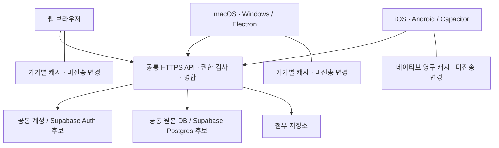

# 웹·데스크톱·모바일과 공통 계정 설계

2026-10-16 재점검. 목표는 웹, macOS, Windows, iOS, Android에서 같은 계정으로 같은 작업공간을 사용하는 것이다. 가족 구성원은 각각의 계정을 사용하고, 공유한 자료만 서로 볼 수 있어야 한다. 아래의 목표 구조와 현재 실행 가능한 구현을 구분한다.

## 현재 확인한 상태

| 항목 | 확인한 구현 | 아직 필요한 작업 |
| --- | --- | --- |
| 웹 | Python HTTP 서버, SQLite 원본 DB, 웹 편집기, 개별 계정·권한, 문서 공동 편집·오프라인 보관 | 상시 접속 가능한 HTTPS 운영 환경 |
| macOS·Windows | 공통 웹 화면과 재사용할 도메인 API | Electron 프로젝트·설치 파일·서명·업데이트·실제 OS 검증 |
| iOS·Android | 작은 화면 대응 웹 UI | 모바일 프로젝트·네이티브 저장소/인증/파일 연결·키보드/실기기 검증 |
| 기기 간 동기화 | 같은 서버를 사용하는 브라우저들은 같은 원본 DB를 읽고 문서 편집을 병합 | 네이티브 전송·인증 연결과 다섯 플랫폼 간 검증 |
| Supabase | 공식 문서·한도 및 도입 경계 검토 | 프로젝트 선택·Auth 연결·Postgres 어댑터·RLS·이관·운영 검증 |

현재 저장소에는 Electron/Capacitor 패키지나 iOS/Android 빌드 프로젝트가 없다. 모바일 크기의 Chrome 테스트는 네이티브 앱 검증을 대신하지 않는다. `localhost:8787`은 접속하는 기기 자신을 가리키므로 휴대폰에서 같은 주소를 여는 것만으로 PC 데이터에 연결되지는 않는다.

## Notion 조사로 확인한 범위

설치된 macOS Notion 7.39.0 번들의 REA 분석에서 Electron의 preload 연결과 SQLite 관련 코드를 확인했다. 분석 대상·해시·재현 결과는 [Desktop 조사](research/notion-desktop.md)에 있다. 이것은 모바일 바이너리나 서버 전체를 조사했다는 뜻이 아니다.

[Electron 공식 문서](https://www.electronjs.org/docs/latest/)의 대상은 Windows·macOS·Linux다. iOS·Android를 Electron 빌드 대상으로 간주하면 안 된다.

[Notion의 2024-05-01 Android 기술 글](https://www.notion.com/blog/notion-on-android-is-now-more-than-twice-as-fast-to-launch)은 WebView 래퍼에서 네이티브 화면으로 확장한 과정과 SQLite 블록 저장, 실시간 데이터 처리, WebView와 네이티브 계층의 MessagePort 통신을 설명한다. 해당 시점의 공식 설명이며 현재 iOS/Android 앱 전체 소스나 최신 바이너리를 검증한 결과는 아니다.

따라서 기존 문서·DB·권한·동기화 구현은 공통 기반으로 유지하되, 데스크톱 분석만으로 모바일 설계가 끝났다고 판단하지 않는다.

## 목표 구조

Electron과 Capacitor는 구현 후보로 선정한 방향이다. 설치하거나 패키징한 상태는 아니다. [Capacitor v8 공식 문서](https://capacitorjs.com/docs)는 웹 화면을 iOS·Android 네이티브 컨테이너에 통합하고 필요한 네이티브 API를 연결하는 방식을 제공한다. 공통 편집기를 재사용하면서 모바일에서 저장소·파일·공유·인증 기능을 단계적으로 연결하는 데 적합하다고 판단했다. 네이티브 성능과 접근성은 실제 기기에서 별도로 확인한다.

모든 클라이언트는 같은 서버 주소와 작업공간 ID를 사용한다. 각 앱에 독립 Python 서버와 새 원본 SQLite DB를 기본으로 넣으면 데이터가 갈라지므로 이 방식으로 기기 간 동기화를 구현하지 않는다. 로컬 서버를 운영하는 경우에도 가족이 연결하는 서버는 하나다.

같은 계정의 기기들은 동일한 사용자 ID를 사용하되 로그인 세션은 기기별로 갖는다. 캐시는 서버 주소·작업공간·사용자·로그인 binding으로 분리한다. 한 기기의 로그아웃은 해당 기기의 캐시를 지우고, 전체 세션 종료나 구성원 비활성화는 서버에서 별도로 집행해야 한다.

문자 편집은 기존 CRDT를 재사용한다. DB 행·페이지 메타데이터는 변경 ID, 수정 전 값, 속성 정의를 가진 작업으로 전송한다. 서버는 현재 권한을 재검사하고, 같은 작업의 재전송을 중복 적용하지 않으며, 동일 필드 충돌은 복구 가능한 상태로 남긴다. 서버가 적용했다고 응답해도 해당 변경을 포함한 원본 스냅샷을 영구 저장하기 전에는 로컬 복구 기록을 지우지 않는다.

## Supabase 도입 경계

Supabase는 공통 Auth와 Postgres의 후보로 검토한다. 현재 SQLite 연결 설정을 Supabase URL로 바꾸는 것만으로 전환되지는 않는다.

| 구성 | 도입 시 역할 | 보존해야 할 동작 |
| --- | --- | --- |
| Auth | 모든 플랫폼의 사용자 식별·세션 | 사용자 ID와 기존 가족 멤버 매핑, 계정 철회·기기별 로그아웃 |
| Postgres | 문서·DB·권한·동기화 기록의 공통 원본 | 작업별 원자적 변경, 중복 방지, 스냅샷 revision, 숨긴 관계 보존 |
| Realtime | 권한 있는 클라이언트에 변경 알림 | 알림을 받은 뒤 현재 권한으로 원본 재조회, 누락·재접속 복구 |
| Storage 또는 별도 저장소 | 첨부 바이트 | 접근 권한, 이어 올리기, 해시, 백업·복원, 파일 크기 한도 |
| 앱 서버 | 기존 도메인 API·CRDT·자동화·AI 실행 | 상시 HTTPS 운영, 서버 측 비밀 관리·감사 기록 |

Realtime 자체가 오프라인 변경 병합·충돌 처리·영구 작업 큐를 제공한다고 가정하지 않는다. 원본 JSON이나 비공개 문서 본문을 전체 작업공간에 무조건 방송하지 않는다. 앱 서버의 배포도 별도 작업이며 Supabase DB를 만든다고 현재 Python 서비스가 자동으로 호스팅되지는 않는다.

Auth 연결에는 검증된 토큰의 사용자 ID를 사용하고, 사용자가 수정할 수 있는 `user_metadata`를 권한의 근거로 사용하지 않는다. 노출하는 테이블은 RLS로 보호하고 사용자·작업공간·문서 권한을 일관되게 적용한다. 서버 전용 secret/service-role 키는 웹·Electron renderer·모바일 번들에 넣지 않는다. 네이티브 OAuth를 도입하면 [딥 링크](https://supabase.com/docs/guides/auth/native-mobile-deep-linking)와 [PKCE](https://supabase.com/docs/guides/auth/sessions/pkce-flow), OS 보안 저장소와 세션 갱신을 함께 설계한다. 기존 세션/권한 철회 정책도 유지한다.

Supabase의 [로그아웃 기본 scope는 global](https://supabase.com/docs/guides/auth/signout)이므로 기기별 로그아웃에는 `local`을 명시한다. 이미 발행한 access JWT는 만료 전까지 유효할 수 있다. 즉시 철회가 필요한 API는 서명·만료 검증에 더해 현재 세션의 유효성을 확인해야 한다. 공식 [세션 검증 안내](https://supabase.com/docs/guides/auth/sessions#how-to-ensure-an-access-token-jwt-cannot-be-used-after-a-user-signs-out)를 따른다. 로컬 cache binding은 주기적으로 갱신되는 access JWT 문자열 대신 안정적인 세션 식별자에 연결한다.

현재 Store는 SQLite 트랜잭션·SQL·BLOB 읽기와 백업에 직접 의존한다. Postgres 어댑터와 첨부 저장소 경계를 먼저 분리한 후 같은 계약 검증을 실행해야 한다. 여러 REST 요청을 보내는 것만으로 기존 작업의 원자성이 유지된다고 간주하지 않는다. 이관은 기존 SQLite를 보존한 상태에서 임시 대상에 복원·개수·해시·권한·작업 재전송을 검증한 뒤 전환한다.

[Supabase DB 백업은 Storage 객체 바이트를 포함하지 않는다](https://supabase.com/docs/guides/platform/backups). 기존 SQLite 전체 백업과 동등한 복구를 제공하려면 DB dump와 객체 파일·해시 manifest를 함께 보관하고 참조가 일치하는 시점으로 복원해야 한다. Free에서 관리형 자동 DB 백업까지 제공된다고 가정하지 않으며, 직접 내보내기와 실제 복원 검증이 필요하다.

### 무료 사용의 범위

2026-10-16 [Supabase 가격표](https://supabase.com/pricing)에서 확인한 Free 기준은 DB 500MB, 파일 저장소 1GB, 일반 egress 5GB와 cached egress 5GB다. 비활성 프로젝트는 일주일 후 일시 정지될 수 있다. [Storage 한도 문서](https://supabase.com/docs/guides/storage/uploads/file-limits)의 무료 플랜 파일당 최대치는 50MB다. 이후 변경될 수 있으므로 실제 프로젝트 연결 때 다시 확인한다.

현재 앱의 파일당 5GB 지원을 Supabase Free Storage에 그대로 옮길 수 없다. 큰 첨부는 별도의 자체 운영 저장소 또는 요구 한도를 지원하는 서비스가 필요하다. 무료 DB의 용량에는 문서 이력·동기화 기록 증가도 고려해야 한다. 앱 안의 기능에 결제 제한을 넣지 않는 것과 호스팅·저장소·네트워크·AI 공급자의 비용은 별개다. 무료 인프라에서 무제한 용량과 상시 가용성을 보장하지 않는다.

## 실제 앱으로 연결하기 전에 필요한 작업

1. 공통 서버 주소, 안정적인 사용자/작업공간 식별, 재시도 가능한 동기화 계약을 확정한다. 브라우저 캐시와 큐를 이 계약에 연결한다.
2. `fetch`·EventSource·업로드 XHR의 상대 `/api` 경로를 공통 전송 계층으로 모은다. 현재 서버는 HTTP Origin과 같은 출처 쿠키를 전제로 한다. 로그인 쿠키는 `HttpOnly; SameSite=Strict`이며 로컬 HTTP용으로 `Secure` 속성이 없다. 클라이언트도 교차 출처 인증 전송을 구성하지 않았으므로 서버 URL만 바꾸면 네이티브 로그인·실시간 연결이 완성되지 않는다. HTTPS 쿠키 정책 또는 네이티브 인증 전송을 구현하고 세션 철회를 검증해야 한다. 허용 Origin을 무조건 풀어 해결하지 않는다.
3. 공통 HTTPS 서버를 준비한다. Supabase를 선택하면 Auth·Postgres 경계와 이관을 먼저 검증하며 현재 로컬 DB를 유지한다.
4. Electron과 Capacitor 프로젝트를 추가하고 공통 화면을 연결한다. iOS/Android는 영구 캐시·Keychain/Keystore·앱 중단·복귀·파일 선택·공유를 각각 검증한다. 브라우저 IndexedDB가 모든 모바일 상황에서 영구 보존된다고 가정하지 않는다.
5. macOS·Windows 설치 파일과 iOS·Android 패키지를 실제로 빌드하고, 서명·설치·업데이트·배포 방법을 정한다. 현재 네이티브 SDK 의존성 추가와 빌드/서명은 미진행이다.

완료 기준은 다섯 플랫폼에서 같은 계정으로 로그인하고, 문서·DB·댓글·공유 설정·첨부의 생성·편집·삭제가 다른 기기에 반영되는 것이다. 이어서 동시 편집, 오프라인 재시작·재접속, 같은 필드 충돌, 권한 철회, 로그아웃 후 늦은 응답, 다른 가족의 비공개 자료 차단까지 확인한다. 설치 가능한 앱과 이 검증이 갖춰지기 전에는 전체 플랫폼 지원 완료로 표시하지 않는다.
