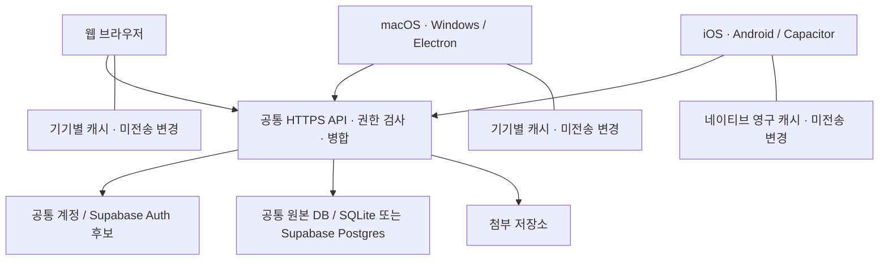

# 웹·데스크톱·모바일과 공통 계정 설계

2026-10-16 재점검. 목표는 웹, macOS, Windows, iOS, Android에서 같은 계정으로 같은 작업공간을 사용하는 것이다. 가족 구성원은 각각의 계정을 사용하고, 공유한 자료만 서로 볼 수 있어야 한다. 아래의 목표 구조와 현재 실행 가능한 구현을 구분한다.

## 현재 확인한 상태

| 항목 | 확인한 구현 | 아직 필요한 작업 |
| --- | --- | --- |
| 웹 | Python HTTP/선택 HTTPS 서버, SQLite 또는 선택 PostgreSQL 원본 DB, 웹 편집기, 개별 계정·권한, 문서 공동 편집·오프라인 보관 | 인증서 운영·상시 접속 가능한 서버 배포 |
| macOS·Windows | Electron 44.8.0, 서버별 저장소, macOS arm64 실제 앱 실행·로그인/문서/SSE·재시작, Windows x64 portable 생성 | Windows OS 실행, 서명·업데이트·설치 프로그램 |
| iOS·Android | Capacitor 8.5.3, 실제 iOS Simulator/Android Debug 빌드, 격리 SDK 검사와 mock bridge+실제 HTTP/Chrome 검증 | 물리 기기·실제 보안 저장소 장애·전체 TLS/파일 흐름·키보드·중단/복귀·영구 outbox·배포 검증 |
| 기기 간 동기화 | 같은 서버를 사용하는 브라우저들은 같은 원본 DB를 읽고 문서 편집을 병합 | 네이티브 전송·인증 연결과 다섯 플랫폼 간 검증 |
| Supabase | 서울 원본 DB·강제 RLS·최소 권한·TLS, 공유 파일 저장소, 기존 자료/계정 이관, 실제 5GB 저장소·SQLite 백업 복원 검증 | 상시 HTTPS 서버 운영·Supabase Auth 연결·대용량 전체 HTTP 전송 성능 |

승인한 Electron/Capacitor 버전을 고정하고 두 데스크톱 패키지와 iOS/Android 프로젝트를 생성했다. [데스크톱 실행·검증](../apps/desktop/README.md)과 [모바일 실행·한계](../apps/mobile/README.md)를 구분한다. 모바일 크기의 Chrome 테스트는 네이티브 앱 검증을 대신하지 않는다. `localhost:8787`은 접속하는 기기 자신을 가리키므로 휴대폰에서 같은 주소를 여는 것만으로 PC 데이터에 연결되지는 않는다.

## Notion 조사로 확인한 범위

설치된 macOS Notion 7.39.0 번들의 REA 분석에서 Electron의 preload 연결과 SQLite 관련 코드를 확인했다. 분석 대상·해시·재현 결과는 [Desktop 조사](research/notion-desktop.md)에 있다. 이것은 모바일 바이너리나 서버 전체를 조사했다는 뜻이 아니다.

[Electron 공식 문서](https://www.electronjs.org/docs/latest/)의 대상은 Windows·macOS·Linux다. iOS·Android를 Electron 빌드 대상으로 간주하면 안 된다.

[Notion의 2024-05-01 Android 기술 글](https://www.notion.com/blog/notion-on-android-is-now-more-than-twice-as-fast-to-launch)은 WebView 래퍼에서 네이티브 화면으로 확장한 과정과 SQLite 블록 저장, 실시간 데이터 처리, WebView와 네이티브 계층의 MessagePort 통신을 설명한다. 해당 시점의 공식 설명이며 현재 iOS/Android 앱 전체 소스나 최신 바이너리를 검증한 결과는 아니다.

따라서 기존 문서·DB·권한·동기화 구현은 공통 기반으로 유지하되, 데스크톱 분석만으로 모바일 설계가 끝났다고 판단하지 않는다.

## 목표 구조

Electron과 Capacitor를 승인받아 프로젝트 전용 의존성으로 설치했다. 데스크톱은 같은 서버의 화면을 직접 열고, 모바일은 로컬 번들과 자체 native 전송을 연결하는 방식으로 구현 중이다. [Capacitor v8 공식 문서](https://capacitorjs.com/docs)는 웹 화면을 iOS·Android 네이티브 컨테이너에 통합하고 필요한 네이티브 API를 연결하는 방식을 제공한다. 공통 편집기를 재사용하면서 모바일에서 저장소·파일·공유·인증 기능을 단계적으로 연결하는 데 적합하다고 판단했다. 네이티브 성능과 접근성은 실제 기기에서 별도로 확인한다.

모든 클라이언트는 같은 서버 주소와 작업공간 ID를 사용한다. 각 앱에 독립 Python 서버와 새 원본 SQLite DB를 기본으로 넣으면 데이터가 갈라지므로 이 방식으로 기기 간 동기화를 구현하지 않는다. 로컬 서버를 운영하는 경우에도 가족이 연결하는 서버는 하나다.

같은 계정의 기기들은 동일한 사용자 ID를 사용하되 로그인 세션은 기기별로 갖는다. 캐시는 서버 주소·작업공간·사용자·로그인 binding으로 분리한다. 한 기기의 로그아웃은 해당 기기의 캐시를 지우고, 전체 세션 종료나 구성원 비활성화는 서버에서 별도로 집행해야 한다.

문자 편집은 기존 CRDT를 재사용한다. DB 행·페이지 메타데이터는 변경 ID, 수정 전 값, 속성 정의를 가진 작업으로 전송한다. 서버는 현재 권한을 재검사하고, 같은 작업의 재전송을 중복 적용하지 않으며, 동일 필드 충돌은 복구 가능한 상태로 남긴다. 서버가 적용했다고 응답해도 해당 변경을 포함한 원본 스냅샷을 영구 저장하기 전에는 로컬 복구 기록을 지우지 않는다.

## Supabase 도입 경계

승인받은 무료 조직에 Fountain 프로젝트를 서울 리전으로 생성하고 현재 미리보기의 원본을 PostgreSQL로 전환했다. 기존 SQLite·백업·계정·작업공간 ID·로그인 binding을 보존하며 첨부 청크는 공유 디스크에 저장한다. Supabase Auth는 아직 후보 단계이며 현재는 Fountain 개별 계정을 사용한다. 선택 설치·실행·권한·이관 검증은 [Supabase 안내](SUPABASE.md)에 기록했다.

| 구성 | 도입 시 역할 | 보존해야 할 동작 |
| --- | --- | --- |
| Auth | 모든 플랫폼의 사용자 식별·세션 | 사용자 ID와 기존 가족 멤버 매핑, 계정 철회·기기별 로그아웃 |
| Postgres | 문서·DB·권한·동기화 기록의 공통 원본 | 작업별 원자적 변경, 중복 방지, 스냅샷 revision, 숨긴 관계 보존 |
| Realtime | 권한 있는 클라이언트에 변경 알림 | 알림을 받은 뒤 현재 권한으로 원본 재조회, 누락·재접속 복구 |
| Storage 또는 별도 저장소 | 첨부 바이트 | 접근 권한, 이어 올리기, 해시, 백업·복원, 파일 크기 한도 |
| 앱 서버 | 기존 도메인 API·CRDT·자동화·AI 실행 | 상시 HTTPS 운영, 서버 측 비밀 관리·감사 기록 |

Realtime 자체가 오프라인 변경 병합·충돌 처리·영구 작업 큐를 제공한다고 가정하지 않는다. 원본 JSON이나 비공개 문서 본문을 전체 작업공간에 무조건 방송하지 않는다. 앱 서버의 배포도 별도 작업이며 Supabase DB를 만든다고 현재 Python 서비스가 자동으로 호스팅되지는 않는다.

Auth 연결에는 검증된 토큰의 사용자 ID를 사용하고, 사용자가 수정할 수 있는 `user_metadata`를 권한의 근거로 사용하지 않는다. 노출하는 테이블은 RLS로 보호하고 사용자·작업공간·문서 권한을 일관되게 적용한다. 서버 전용 secret/service-role 키는 웹·Electron renderer·모바일 번들에 넣지 않는다. 네이티브 OAuth를 도입하면 [딥 링크](https://supabase.com/docs/guides/auth/native-mobile-deep-linking)와 [PKCE](https://supabase.com/docs/guides/auth/sessions/pkce-flow), OS 보안 저장소와 세션 갱신을 함께 설계한다. 기존 세션/권한 철회 정책도 유지한다.

Supabase의 [로그아웃 기본 scope는 global](https://supabase.com/docs/guides/auth/signout)이므로 기기별 로그아웃에는 `local`을 명시한다. 이미 발행한 access JWT는 만료 전까지 유효할 수 있다. 즉시 철회가 필요한 API는 서명·만료 검증에 더해 현재 세션의 유효성을 확인해야 한다. 공식 [세션 검증 안내](https://supabase.com/docs/guides/auth/sessions#how-to-ensure-an-access-token-jwt-cannot-be-used-after-a-user-signs-out)를 따른다. 로컬 cache binding은 주기적으로 갱신되는 access JWT 문자열 대신 안정적인 세션 식별자에 연결한다.

Postgres 어댑터는 실제 트랜잭션·SAVEPOINT·작업공간 잠금으로 작업의 원자성을 보존한다. 첨부 조각과 presence의 저장소 경계를 공통 연산으로 분리했다. 여러 REST 요청으로 트랜잭션을 대신하지 않는다. 이관은 기존 SQLite를 보존한 상태에서 임시 대상의 개수·해시·권한·작업 재전송을 검증한 뒤 전환한다.

[Supabase DB 백업은 Storage 객체 바이트를 포함하지 않는다](https://supabase.com/docs/guides/platform/backups). 기존 SQLite 전체 백업과 동등한 복구를 제공하려면 DB dump와 객체 파일·해시 manifest를 함께 보관하고 참조가 일치하는 시점으로 복원해야 한다. Free에서 관리형 자동 DB 백업까지 제공된다고 가정하지 않으며, 직접 내보내기와 실제 복원 검증이 필요하다.

### 무료 사용의 범위

2026-10-16 [Supabase 가격표](https://supabase.com/pricing)에서 확인한 Free 기준은 DB 500MB, 파일 저장소 1GB, 일반 egress 5GB와 cached egress 5GB다. 비활성 프로젝트는 일주일 후 일시 정지될 수 있다. [Storage 한도 문서](https://supabase.com/docs/guides/storage/uploads/file-limits)의 무료 플랜 파일당 최대치는 50MB다. 이후 변경될 수 있으므로 실제 프로젝트 연결 때 다시 확인한다.

현재 앱의 파일당 5GB 지원을 Supabase Free Storage에 그대로 옮길 수 없다. 현재는 큰 첨부의 바이트를 서버 디스크에 보관하고 DB에는 해시 manifest만 둔다. 이 저장소의 실제 5GB 전체 읽기·범위 다운로드·백업 복원을 검증했으며 전체 HTTP 5GB 전송 성능은 별도 측정 대상이다. 무료 DB의 용량에는 문서 이력·동기화 기록 증가도 고려해야 한다. 앱 안의 기능에 결제 제한을 넣지 않는 것과 호스팅·저장소·네트워크·AI 공급자의 비용은 별개다. 무료 인프라에서 무제한 용량과 상시 가용성을 보장하지 않는다.

## 실제 앱으로 연결하기 전에 필요한 작업

1. 공통 서버 주소, 안정적인 사용자/작업공간 식별, 재시도 가능한 동기화 계약을 사용한다. 웹 화면의 문서·DB 행·새 페이지·메타데이터 편집은 기기별 캐시와 작업 큐에 연결했다. 네이티브 저장소·전송 어댑터도 같은 계약을 유지해야 한다.
2. `fetch`·EventSource·업로드 XHR·다운로드·공개/공유 링크를 `static/transport.js`로 모았다. 브라우저·Electron은 같은 출처 연결을 유지한다. 모바일은 자체 plugin에서 비공개 Cookie를 주입하고 Set-Cookie를 제거하며, 기존 서버의 Origin·인증 규칙을 완화하지 않는다. Android 전용 AVD에서는 실제 native HTTPS·보안 쿠키의 프로세스 재시작·로그아웃·OS 파일 저장을 검증했다. iOS는 실제 Swift/SQLite·WebView 검사까지 확인했으며 원격 HTTPS와 OS 파일 저장 완료는 남아 있다. 로그인 쿠키는 `HttpOnly; SameSite=Strict`이고 직접 HTTPS에서는 `Secure`도 설정한다. 서버 URL만 바꾸면 네이티브 로그인·실시간 연결이 완성되지 않는다. 네이티브 인증 전송과 세션 철회를 검증해야 한다. 허용 Origin을 무조건 풀어 해결하지 않는다.
3. `--tls-cert`·`--tls-key`로 직접 TLS 1.2 이상의 HTTPS를 제공할 수 있다. 인증서 발급·갱신과 공통 서버의 상시 운영 배포는 남아 있다. 실제 소켓의 HTTP/HTTPS에 맞는 Origin만 허용하며 forwarded 헤더로 이 검사를 바꾸지 않는다. 현재 Supabase 이관과 원본 보존을 검증했으며 로그인은 기존 Fountain 계정을 사용한다.
4. 생성한 iOS/Android 프로젝트를 SDK로 빌드하고 영구 캐시·Keychain/Keystore·앱 중단·복귀·파일 선택·공유를 각각 검증한다. 현재 native bundle의 IndexedDB 오프라인 흐름은 mock 검증이며 OS 퇴거에도 버티는 영구 outbox를 보장하지 않는다.
5. macOS arm64·Windows x64 standalone 결과를 보존하고 Windows 실행 및 모바일 SDK 빌드를 검증한다. 사용자가 Xcode·Android Studio 설정을 마쳤고 기존 SDK로 iOS Simulator·Android Debug 빌드를 확인했다. 배포 서명·설치 프로그램·업데이트·상시 배포는 남아 있으며 실제 기기 배포에는 사용자 계정과 서명 설정이 필요하다.

완료 기준은 다섯 플랫폼에서 같은 계정으로 로그인하고, 문서·DB·댓글·공유 설정·첨부의 생성·편집·삭제가 다른 기기에 반영되는 것이다. 이어서 동시 편집, 오프라인 재시작·재접속, 같은 필드 충돌, 권한 철회, 로그아웃 후 늦은 응답, 다른 가족의 비공개 자료 차단까지 확인한다. 설치 가능한 앱과 이 검증이 갖춰지기 전에는 전체 플랫폼 지원 완료로 표시하지 않는다.

## 공통 연결 기반의 검증

`tests/test_tls.py`는 임시 인증서를 신뢰한 실제 HTTPS 연결로 TLS 1.2, 로그인·로그아웃의 Secure 쿠키, Host/Origin 거절, SSE, 파일 구간 다운로드와 잘못된 인증서의 시작 실패를 검사한다. TLS handshake를 끝내지 않은 연결이 다른 요청을 막지 않는 것도 확인한다.

`node tests/browser-https.mjs`는 해당 임시 인증서의 공개 키만 허용한 Chrome으로 같은 이메일 계정의 서로 다른 로그인 세션, 실시간 문서 편집, HTTPS 서비스 워커 오프라인 재시작·재접속, 두 조각의 파일 전송과 다른 세션의 바이트 일치 다운로드를 검사한다. 인증서 예외는 이 테스트 프로세스의 임시 키에만 적용하며 앱 실행 기본값이 아니다.

`node tests/browser-transport.mjs`는 실제 계정·문서·파일·양식·사이트·백업이 공통 연결 경계를 사용하는지, 외부 URL·경로 순회·리다이렉트를 거절하는지 검사한다. 두 Chrome 컨텍스트의 검증은 웹 공통 기반의 증거이며 macOS·Windows·iOS·Android 앱 빌드나 실기기 검증을 대신하지 않는다.

## 이번 네이티브 검증

실제 macOS packaged Electron에서 로그인·문서·독립 Chrome의 수정 수신·IDB/SW·폼/사이트 팝업·재시작·동시 서버 전환 14개를 확인했다. 보안 실행 5개와 정책/전환 단위 8개도 통과했다. Windows는 PE32+ x64·ASAR source 일치·ZIP CRC/해시까지만 검증했다.

모바일은 mock native bridge와 실제 임시 HTTP/Chrome으로 유효 4MiB·16MiB 응답, 4MiB+113바이트 청크, 파일/백업/내보내기, 계정·서버 범위, 실제 Capacitor 오류 형태의 오프라인 재시작/재전송과 저장소 실패 차단을 확인했다. JVM 정책·저장 실패 분기 114개도 통과했다. 이것은 모바일 SDK·실제 TLS·Keychain/Keystore·OS 파일 UI·실기기 다섯 플랫폼 동기화의 증거가 아니다.

SQLite outbox의 기반 코드는 기본 비활성 상태입니다. 정상 모바일 경로는 기존 IDB를 보존하고 앱 캐시로 안내하며, 현재 접근 검증 코드·남은 자료 재조정/승격·기기 검증 조건은 [모바일 저장소 개발 상태](NATIVE_OUTBOX.md)를 따릅니다.

이전 네이티브 기록의 읽기 전용 목록·현재 권한 확인·명시적 OS 파일 내보내기는 [기기 복구 안내](NATIVE_RECOVERY.md)를 따른다. 일반 outbox는 계속 비활성이며 자동 승격·재전송은 하지 않는다.

2026-10-16 실제 SDK 검증 범위:

| 대상 | 확인한 동작 | 남은 범위 |
| --- | --- | --- |
| iOS Simulator | unsigned build·설치·실행, Swift/SQLite 복구·WebView 차단 XCTest 6개 | 원격 HTTPS 로그인·Keychain 실패·OS 저장 완료·물리 기기 |
| Android API 36 AVD | Debug APK, 실제 WebView→native HTTPS·SQLite 복구, 시스템 저장 취소/완료, 저장 JSON 원문 일치, 보안 쿠키 강제 종료/복원·로그아웃 | 물리 기기·저장 실패/공간 부족·앱 캐시 퇴거·장시간 대용량 전송 |

두 대상 모두 일반 영구 outbox는 기본 비활성 상태다. 테스트 CA는 Android
Debug 전용이며 릴리스 인증서 검증을 바꾸지 않는다. 기존 사용자 가상 기기와
생산 데이터는 시험에 사용하지 않았다.
